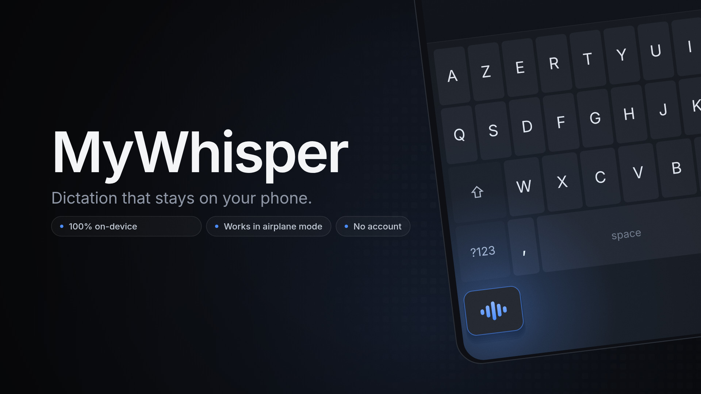

# MyWhisper

Dictation that never leaves your phone.

<picture>
  <source media="(max-aspect-ratio: 1/1)" srcset="docs/img/hero-4x3.jpg">
  
</picture>


MyWhisper is a small personal Android project: a voice-typing key that sits above Gboard's
space bar, in the spirit of **Nothing's Essential Voice** — tap it, talk, tap again and the
text is written into whatever field you were in. Recognition runs entirely on the device
with an AI model ([NVIDIA Parakeet TDT 0.6B v3](https://huggingface.co/ggml-org/parakeet-GGUF),
quantized): no account, no API key, no audio sent anywhere. It works in airplane mode.

> Version **1.1.12**. Signed APK (~6 MB, arm64, Android 12+): [Releases](https://github.com/Espilonn/MyWhisper/releases/latest).
> The internal identifiers (`dev.voxkey.bench`, `voxkey.db`, `voxkey` preferences) are leftovers
> from the working name "voxkey" and have not been migrated — renaming them would create a second
> app and force a model re-download.

## Features

- **A voice key, not a keyboard.** A 56 × 44 dp bubble is attached to the keyboard window, at the
  left end of the space bar. Nothing to install or switch to: it appears with Gboard and disappears
  with it.
- **Tap to talk, tap to transcribe.** First tap starts recording, second tap stops and transcribes.
  The result is written at the cursor of the focused field, in any app.
- **History.** Every dictation is stored locally with its date and word count; browse, reread or
  delete it.
- **Usage graph.** Words per day over a week, a month or six months — a contribution-style grid,
  a total, the change versus the previous period, and the detail of any day you tap.
- **Keywords.** A spoken abbreviation (`sig`) becomes its full saved text (`Best regards, Alex`),
  but only when dictated on its own, so ordinary words are never rewritten mid-sentence.
- **Dictionary.** Your own names, brands and technical terms, kept on the phone as a list.
  It is not yet fed to the model — it is a reference list, not a correction pass.
- **Adjustable accent colour.** Yellow by default; the whole app and the bubble follow the choice.
- **A bubble that blends in.** Or mostly: it reads the keyboard's own background once per opening
  (one screenshot, cropped to the keyboard, median of a pixel grid, kept in memory and never
  written to disk) and picks the ink that stays legible on it. Dark and accent colours remain
  available if you prefer a key that stands out.
- **Adjustable position.** Two sliders in the settings, over a preview of Gboard, move the bubble
  across the keyboard; the preview draws it where it will really land. The default is the old
  spot, and the position follows rotation, foldables and a resized keyboard.
- **Bilingual UI.** French and English; the app follows the system language (French is the
  default when the locale is neither).

## How it works

```
Gboard (system keyboard)
  └─ MyWhisper key, attached to the keyboard window
        │  tap
        ▼
OverlayService (foreground service, microphone type)
        │  AudioRecord 16 kHz mono → float PCM
        ▼
ParakeetEngine (JNI → ggml / whisper.cpp)
        │  text
        ▼
VoxkeyAccessibilityService
        └─ written into the focused field
```

Three ideas carry the whole thing:

1. **The key is a surface grafted onto the keyboard window** (`SurfaceControlViewHost`,
   `attachAccessibilityOverlayToWindow`). It therefore moves, appears and vanishes *with* Gboard,
   stays above it, and needs no draw-over-other-apps permission in that mode. The vertical position
   is computed in the keyboard window's frame, so Gboard's opening animation cannot disturb it.
2. **Text insertion goes through an accessibility service**, which sets the text of the focused
   node (with clipboard + paste as a fallback). That is what makes it work in any app rather than
   only in apps written for it.
3. **The model is loaded while you speak**, then freed 60 s after the dictation. Encoder time is
   therefore hidden behind recording, which is why everyday use feels almost instant.

A model file's kind selects the engine: a Parakeet file goes to `ParakeetEngine`, a Whisper ggml
file to `WhisperEngine`. Only Parakeet models are offered for download in the app.

## Models

Downloaded from Hugging Face into the app's private storage, resumable via a `.part` file:

| File | Size | Use |
|---|---|---|
| `ggml-parakeet-tdt-0.6b-v3-q4_k.bin` | 415 MB | default, the fastest |
| `ggml-parakeet-tdt-0.6b-v3-q8_0.bin` | 668 MB | more accurate, heavier |

No Q6_K exists upstream; Q8_0 is the next quality step. Only one ABI is shipped (`arm64-v8a`).

## Performance

Measured on a Nothing Phone (3a), Snapdragon 7s Gen 3, 4 threads, Parakeet Q4_K:

| | Time |
|---|---|
| Transcribing 11 s of audio | **1.5 s** (encoder 1.21–1.39 s, decoder 3 ms) |
| Real-time factor | **0.14** — about 7× faster than the audio |
| Model load | 0.5–1.1 s depending on the pass (file already in the page cache) |

Two successive runs gave 1,522 ms and 1,544 ms — a 1.4 % spread, so the figure holds. The encoder
accounts for more than 95 % of the time; decoding is negligible. Because the model loads *during*
the dictation, the wait after stopping is close to encoding alone.

> These numbers come from the engine's own timing (`parakeet_get_timings()`, clock around the whole
> call); the app shows and records them in its benchmark screen. Method:
> [docs/benchmark.md](docs/benchmark.md). Rejected options: [docs/decisions.md](docs/decisions.md).

## Install

MyWhisper does not come from Google Play, so Android puts up several blocks before dictation works.
All of them are one-time. The in-app **Get started** card tracks the last three and opens each
screen for you.

1. **Let the phone install the APK.** Tap the downloaded file; if Android refuses, allow *Install
   unknown apps* for whatever opened it (Files, Chrome…). The in-app updater needs that same switch
   later.
2. **Get past Play Protect if it blocks.** An APK that declares an accessibility service is
   sometimes stopped with *App blocked to protect your device → This app can request access to
   sensitive data*, and no install button is offered. Turning off *Play Store → profile → Play
   Protect → ⚙ → Scan apps with Play Protect* may lift it, but often does not: the rule is keyed on
   the permission itself. If it stays blocked, use one of the two routes in
   [Play Protect blocks the install](#play-protect-blocks-the-install).
3. **Open MyWhisper and download a model.** 415 MB for Q4_K, 668 MB for Q8_0. Prefer Wi-Fi — see
   [The model download stalls](#the-model-download-stalls) if the progress line freezes.
4. **Allow notifications, microphone and overlay.** Notifications and microphone are ordinary
   runtime prompts; *Draw over other apps* is a separate screen, which the card opens.
5. **Enable the accessibility service.** *Settings → Accessibility → MyWhisper → On*. If the toggle
   is greyed out, allow restricted settings first: *Settings → Apps → MyWhisper → ⋮ → Allow
   restricted settings*. No text is typed into other apps without this step.
6. **Turn the dictation key on**, then open any text field: the key appears above the keyboard.

Remote install (device on the same tailnet): [docs/remote-install.md](docs/remote-install.md).

### Updates

From 1.1.4 on, the app asks GitHub for the latest release at launch, at most once a day. When one is newer, the status pill on the home screen turns into **↑ Update**: tap it to read the release notes and install. The APK is downloaded by the app itself and handed to the system installer — no browser, no manual download.

Two Android switches matter:
- **Install unknown apps** — tapping *Install* opens the right screen; allow MyWhisper there.
- **Play Protect** can still show "This app can request access to sensitive data" on the update, exactly like the first install. Same workaround, below.

Self-update is turned off when MyWhisper was installed from Google Play (`com.android.vending`), as Play policy requires.

### Play Protect blocks the install

An APK that declares an accessibility service trips Google Play Protect: the phone
shows *App blocked to protect your device — This app can request access to sensitive
data* and offers **no install button**. The block is automatic and is keyed on the
`BIND_ACCESSIBILITY_SERVICE` permission itself, not on what the code does.

Two ways through:

- **adb** — enable *Developer options → USB debugging*, plug the phone in, then:
  ```
  adb install -r MyWhisper-1.1.12-arm64.apk
  ```
  If it answers `INSTALL_FAILED_VERIFICATION_FAILURE`, turn off
  *Developer options → Verify apps over USB* and retry.
- **Play internal testing** — upload the same APK to an internal test track. Play
  becomes the installer, so the block never appears; it is the only route that works
  for other people without a cable. A Play developer account is required, and Play
  now asks for `targetSdk` 36 (this app targets 35).

Turning off *Play Protect → Scan apps with Play Protect* does not lift the block in
most cases — that setting controls the scanner, not the sensitive-permission rule.

### The accessibility toggle is greyed out

Android 13+ refuses accessibility to sideloaded apps ("restricted settings"). In
*Settings → Apps → MyWhisper*, open the **⋮** menu at the top right and pick
*Allow restricted settings*, then enable the service. The app's setup card shows a
button that opens that page.

### Replacing a debug build

Debug and release APKs are signed with different keys, so neither can overwrite the
other (`INSTALL_FAILED_UPDATE_INCOMPATIBLE`). Uninstall first — `adb uninstall
dev.voxkey.bench` — which also deletes the downloaded model.

### The model download stalls

Some Wi-Fi networks (filtering router, ad-hoc DNS, transparent proxy) stall the
Hugging Face CDN while mobile data goes through at full speed. If the progress line
does not move, try another network; a partial download is discarded, never used.

## Limitations

- **Google Play**: writing into other apps through an accessibility service is not allowed there.
  Distribution goes through an APK, F-Droid or Obtainium — or a real `InputMethodService`, which
  does not exist yet.
- **Android 12+** required (`minSdk 31`).
- The key is anchored to Gboard's window; other keyboards have not been validated.
- Reading the keyboard colour needs the screenshot capability of the accessibility service:
  after an update of the app, toggle the service off and on once if the bubble stays dark.
- Each dictation pays the model load first (0.5–1.1 s, hidden by recording), then about
  0.15 × the audio duration.
- No licence yet: the code is public but all rights reserved. The `third_party/whisper.cpp`
  submodule keeps its MIT licence.

## Roadmap

- **Stability** of the bubble: attaching the surface to every keyboard opening, surviving service
  restarts and reinstalls without losing permissions.
- **Bring your own model**: pick a local GGUF/ggml file instead of downloading one from the list.
- *Maybe*: spell-and-grammar correction of existing text, rather than only dictating new text.

## Project layout

```
app/src/main/java/dev/voxkey/bench/
  OverlayService.kt              bubble, recording, model lifecycle
  VoxkeyAccessibilityService.kt  insertion into the focused field
  ParakeetEngine.kt              main engine (GGUF, JNI)
  WhisperEngine.kt               Whisper engine (ggml)
  ModelCatalog.kt                model download
  Store.kt                       SQLite: dictations, dictionary, keywords
  MainActivity.kt / *Screen.kt   navigation and screens
  Ui.kt / Accent.kt              design system and accent colour
  DayGrid.kt                     contribution-style day grid
app/src/main/cpp/                JNI + CMake over whisper.cpp
docs/                            decisions, measurements, remote install
```
